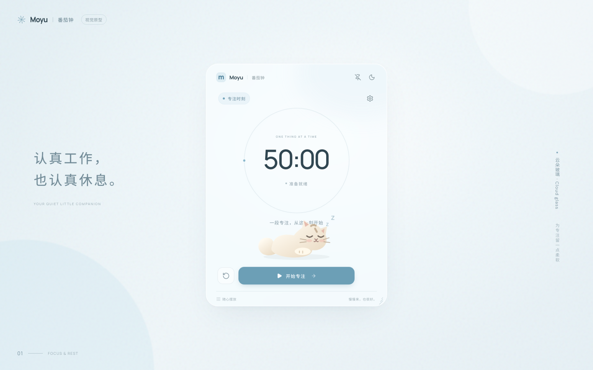

# Moyu番茄钟

一只小猫，陪你认真工作，也认真休息。

淡蓝磨砂、云朵玻璃、50 分钟专注与 10 分钟休息。当前交付是 **macOS 原生应用的网页视觉原型**，不是已经完成的 macOS 安装包。



## 当前可体验

- 可操作的 50/10 计时、暂停、继续和重置。
- 工作结束自动休息，休息结束确认后开始工作。
- 独立时长设置、行内校验、提示音与减少动态效果。
- 浅色/深色、原创 SVG 小猫、拖拽、缩放、固定。
- 设置、计时状态和模拟窗口位置在本机保存。

## 本地预览

需要 Node.js 22.19+ 或 24.12+。

```bash
npm install
npm run dev
```

打开终端显示的 `http://127.0.0.1:5173/`。生产构建：

```bash
npm run build
npm run preview
```

## 验证

```bash
npx playwright install chromium
npm run check
npm run dev
# 在另一个终端运行：npm run screenshots
```

自动测试覆盖计时操作、阶段切换、设置校验、固定/缩放、主题、恢复和窄屏。截图输出至 `artifacts/`。网页通知依赖浏览器授权；macOS 原生系统通知尚未实现或验证。

## 产品与技术文档

- [PRD：目标、边界、流程和验收](docs/PRD.md)
- [产品经理学习地图](docs/PRODUCT_MANAGEMENT_GUIDE.md)
- [技术选型与原生验证边界](docs/TECHNICAL_DECISIONS.md)
- [需求追踪与测试证据](docs/TRACEABILITY.md)

## 开发边界

当前阶段仅用于视觉与交互验收。你确认后，才进入 SwiftUI/AppKit 原生开发。此时尚无 `.app`、DMG、代码签名或 Apple 公证，请勿将网页原型当成桌面正式版。

## License

MIT © 2026 Moyu。猫咪插画为本项目原创 SVG，未使用第三方猫咪素材。
