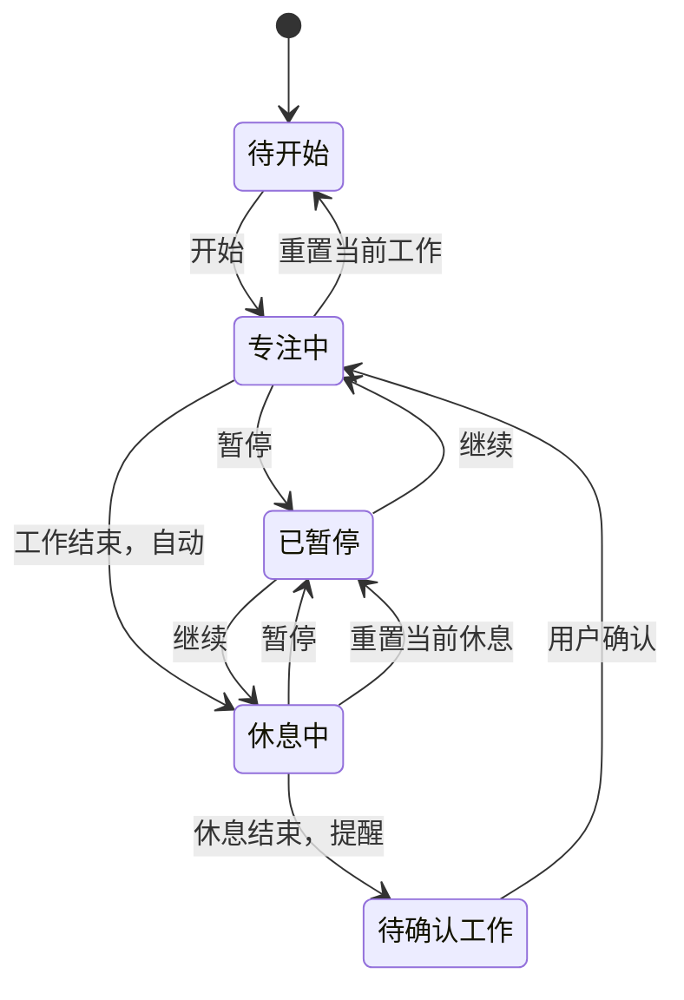

# Moyu番茄钟 PRD v0.1

状态：产品与视觉方案已确认，等待网页 Demo 视觉验收

更新：2026-10-25

产品负责人：Moyu

首版平台：macOS 15+

## 1. 一句话产品

一只小猫陪你认真工作，也认真休息：一个不抢注意力、始终触手可及的桌面番茄钟。

## 2. 问题与目标

目标用户是需要长时间使用 Mac、希望规律工作休息，又不喜欢复杂效率工具的人。

- 问题：计时工具藏在浏览器或手机里，容易忘记；复杂任务系统反而增加启动成本。
- 产品目标：两次点击内开始计时；明确提醒工作与休息；默认节奏开箱即用。
- 设计目标：淡蓝磨砂、时间清晰、猫咪陪伴有变化但不持续打断。
- 非目标：不解决任务管理、团队监督、效率评分或跨设备同步。

## 3. 成功指标

当前无用户基线，以下是首个公开测试版的观察指标，不虚构达成值。

- 首次使用无需说明即可开始 50 分钟专注。
- 核心流程无崩溃、重复通知、计时漂移或状态丢失。
- 用户能够独立找到并修改两种时长、固定窗口、切换主题。
- 通过实际访谈确认：猫咪与动效是陪伴，而不是新的注意力负担。

## 4. 核心用户故事

1. 作为 Mac 用户，我希望直接点击开始，以便不打断当前思路就进入专注。
2. 作为容易忘记休息的人，我希望工作结束自动休息，以便真正离开工作状态。
3. 作为重视节奏自主权的人，我希望休息结束后再确认工作，以便不被工具强行推进。
4. 作为多窗口用户，我希望悬浮窗固定，以便随时看见剩余时间。
5. 作为有个体节奏的人，我希望分别设置时长，以便保留自己的工作和休息习惯。
6. 作为对视觉舒适敏感的人，我希望切换深浅主题、减少动效，以便长时间使用。

## 5. MVP 范围

包含：50/10 默认节奏；开始/暂停/继续/重置；工作到休息自动切换；休息结束等待确认；自定义时长；悬浮窗拖动、缩放、固定；深浅主题；设置与计时恢复；系统通知和提示音；原创猫咪及减少动态效果。

不包含：任务、统计、排行榜、账号、云同步、声音资源商店、Windows、iOS、浏览器正式插件。

## 6. 主流程与状态

## 7. 功能验收

| 编号 | 需求 | 可验收结果 |
|---|---|---|
| T01 | 默认计时 | 首次显示 50:00；休息为 10:00 |
| T02 | 基本操作 | 开始、暂停、继续、重置均有即时且准确的显示 |
| T03 | 时间计算 | 根据结束时间戳校正，不依赖每秒递减 |
| T04 | 工作完成 | 只自动进入休息，不进入下一段工作 |
| T05 | 休息完成 | 停止在待确认状态，通知一次，不自动工作 |
| T06 | 独立设置 | 工作 1–180、休息 1–60 的整数可保存 |
| T07 | 输入异常 | 空白、小数、0、负数和超范围均显示行内错误，不保存 |
| T08 | 设置生效 | 运行中修改不改变当前阶段；待开始状态可刷新默认值 |
| W01 | 拖动与缩放 | 鼠标可操作；限制最小/最大尺寸和屏幕可见边界 |
| W02 | 固定 | 置顶并锁定位置/大小；解锁恢复操作；重开保留 |
| U01 | 主题 | 默认跟随系统，可手动切换浅色/深色，重开保留 |
| U02 | 设置页 | 当前窗内打开、返回，不新增常驻窗口 |
| U03 | 猫咪与动效 | 状态有文字等价表达；系统或应用减少动态效果时停止装饰运动 |
| N01 | 通知 | 原生版申请权限；拒绝后保留窗内状态提醒，不反复索取权限 |
| N02 | 声音 | 可独立关闭、调节音量；关闭不影响计时和通知 |
| R01 | 暂停恢复 | 暂停退出后剩余时间保持不变 |
| R02 | 运行恢复 | 运行退出后按真实结束时间恢复；到期只产生合法目标状态 |

## 8. 异常与边界

- 存储不可用或数据损坏：回退到安全默认值，不崩溃；正式版应给出非阻断提示。
- 休眠/唤醒：醒来立即按真实时间校正，不补播一连串过期动画或通知。
- 系统时间改变：原生运行中以单调时钟避免手工改表干扰；持久化恢复使用绝对结束时间。
- 窗口越界：重开、换屏后夹回可见区域，保留可操作的尺寸。
- 权限拒绝：明确说明系统通知不可用，不阻止使用核心计时。
- 0 秒：休息结束显示 00:00 与“等待开始”；不显示负数。

## 9. 阶段门禁

1. PRD 核心流程确认。
2. 网页 Demo 视觉与交互确认。
3. 原生 MVP 实机功能验收。
4. 自动化、真机、安装包检查通过，发布公开测试版。
5. 测试反馈处理完毕，再决定是否发布 v1.0.0。

## 10. 本次交付状态

- [x] 产品边界和交互约定确认。
- [x] 网页 UI Demo 实现。
- [ ] 网页视觉由用户验收。
- [ ] 原生 macOS 开发（网页验收后才启动）。
- [ ] 原生安装包、签名/公证与正式发布。
